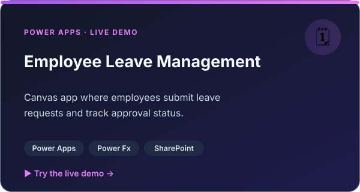
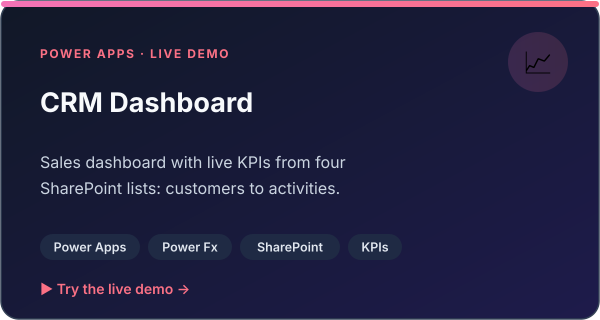
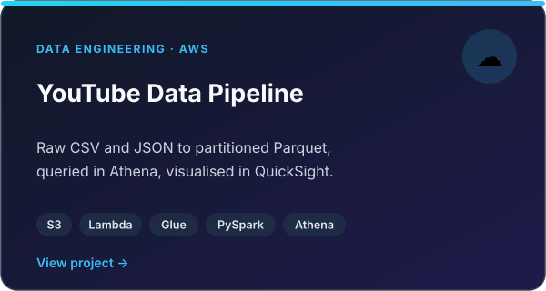
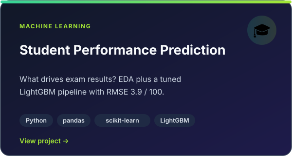
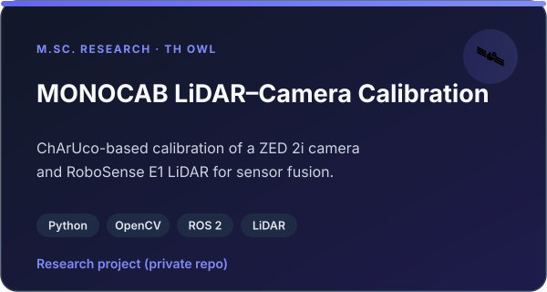
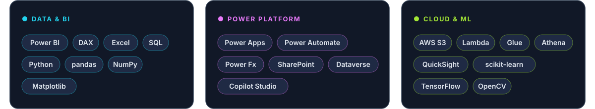

  

  &nbsp;
  &nbsp;
  

 

  I turn data into <b>dashboards</b> and <b>automated workflows</b>. 
  M.Sc. IT student at TH OWL · ex-working student at <b>E.ON Digital Technology</b> · open to <b>Werkstudent</b> roles in NRW

 

## 🚀 Featured projects

<table>
  <tr>
    <td width="50%" align="center">
      
      <a href="https://navya1223.github.io/Employee-Leave-Management/">Live demo</a> · <a href="https://github.com/Navya1223/Employee-Leave-Management">Repository</a>
    </td>
    <td width="50%" align="center">
      
      <a href="https://navya1223.github.io/CRM-Management-System/">Live demo</a> · <a href="https://github.com/Navya1223/CRM-Management-System">Repository</a>
    </td>
  </tr>
  <tr>
    <td width="50%" align="center">
      
    </td>
    <td width="50%" align="center">
      
    </td>
  </tr>
  <tr>
    <td width="50%" align="center">
      
    </td>
    <td width="50%" align="center">
      
    </td>
  </tr>
</table>

## 🧰 Tech stack

  

## 💼 Experience

| Role | Company | Highlights |
| :-- | :-- | :-- |
| Working student, Controlling | **E.ON Digital Technology** · 2025 | Extended the finance Power BI dashboard (~5 new pages, ~100 users), automated forms with Power Apps & Power Automate |
| Data Analyst | **KheyDigit** · 2023–24 | Analysed a year of retail sales data; recommendations adopted by the store owner |
| M.Sc. research project | **TH OWL** · 2025–26 | LiDAR–camera calibration and sensor fusion for the MONOCAB autonomous rail vehicle |

Let's connect on <a href="https://www.linkedin.com/in/navya-geethika-namburi-11b68325a">LinkedIn</a> or at navyan1223@gmail.com

